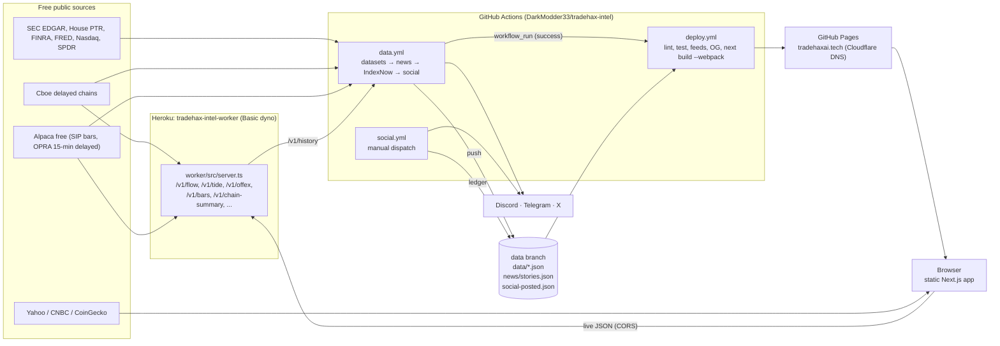

# TradeHax Intel

**A free, open alternative to Unusual Whales.** Options flow, dealer gamma, volatility, dark-pool-style off-exchange prints, filings (insiders, Congress, 13F), shorts, screeners, backtests, and an auto-generated market newswire. All of it runs on free tiers.

- **Live site:** https://tradehaxai.tech/ (GitHub Pages, with DNS on Cloudflare)
- **Live worker:** Heroku app `tradehax-intel-worker` (`/health` is public)
- **Newswire:** https://tradehaxai.tech/news/ ([RSS](https://tradehaxai.tech/news/feed.xml) · [Atom](https://tradehaxai.tech/news/atom.xml))
- **Social:** stories post on their own to Discord and to the Telegram channel **Intel** (`t.me/tradehsxintel`). X is wired up and waits for API keys.

> **Taking over this repo?** Read [`docs/HANDOFF.md`](docs/HANDOFF.md) first. It covers the two-repo setup, where secrets and state live, the gotchas, and the open tasks. [`docs/BUILD_LOG.md`](docs/BUILD_LOG.md) is the dated history of every batch and fix.

TradeHax is research software. It is not a broker or investment advice, and a high score does not promise profit. Every number on screen comes from a named public source. Nothing is invented. Delayed or inferred data is labeled.

---

## Features and routes

The site is a static export, so every route is a pre-rendered page that fetches data in the browser. Parameters go in the query string (`/chart/?s=NVDA`), not in `[param]` segments. The only dynamic segments are the news pages, which are generated at build time from `stories.json`.

| Group | Route | What it does |
|---|---|---|
| Desk | `/` | Watchlist plus a ranked signal feed (EMA, MACD, RSI, VWAP, and volume votes) across 1m to 1D, with measured hit rates |
| | `/news/`, `/news/YYYY/MM/slug/`, `/news/t/TICKER/`, `/news/type/TYPE/` | Auto-generated newswire, plus per-ticker and per-type hubs |
| | `/t/?s=` | Ticker hub with tabs (Overview, Chart, Options, Flow, Filings, Shorts, Earnings) and a watchlist star |
| | `/alerts/` | Browser alert rules. Web push stays off until VAPID keys exist. |
| | `/screener/` | Screener over the Nasdaq universe, with a query language, presets, a column picker, and CSV export |
| Charts | `/chart/` | Candles from lightweight-charts, studies, and gamma and flow overlays |
| | `/backtest/` | Backtest lab that fills at the next open, with costs, a parameter sweep, and DSR and Wilson statistics |
| | `/rotation/`, `/map/` | Sector and factor rotation, a relative-strength map, and a correlation matrix |
| | `/macro/` | Rates and macro data from public FRED CSV |
| | `/lab/` | In-browser Python (Pyodide from a CDN, loaded only on request) |
| | `/seasonality/`, `/markets/` | Monthly seasonality and the cross-asset board |
| Options | `/chain/`, `/gex/`, `/vol/`, `/strategy/`, `/oi/`, `/flow/hot/`, `/spx/`, `/c/?occ=` | Delayed chain, gamma, DEX, max pain, IV rank and term structure, a strategy builder, OI change, hot contracts, SPX positioning, and the contract detail page with an unusual score |
| Flow (worker) | `/flow/`, `/flow/alerts/`, `/flow/interval/`, `/flow/history/`, `/tide/`, `/offex/` | Live tape (15-minute-delayed Alpaca OPRA prints, with sweep, block, and multi-leg flags), tide, NOPE, and off-exchange TRF prints |
| Structure / Filings / Calendar | `/shorts/`, `/insiders/`, `/congress/`, `/institutions/`, `/earnings/`, `/calendar/`, `/etf/` | Datasets precomputed by the `data` workflow |
| Other | `/portfolio/`, `/workspace/`, `/popout/`, `/status/`, `/about/`, `/about/methodology/`, `/offline/` | Browser-only paper book, a saved grid of panels, the PiP tape, dataset and worker health, and methodology |

SEO outputs: `/sitemap.xml` (`src/app/sitemap.ts`), `/robots.txt`, `/news-sitemap.xml` (the Google News sitemap for the last 48 hours), RSS and Atom feeds, OG card images under `/news/og/`, per-page metadata, and an IndexNow key file at `/a7c3e91b4d2f48e0a1b6c5d4e3f2a190.txt`. The site also ships a PWA manifest and a service worker (`public/sw.js`).

## Architecture



There are three parts, and none of them is a paid service:

1. **Static site** (`src/`). Next.js 16 App Router with `output: "export"` and `trailingSlash: true`. No server and no API routes. Browser code fetches the public sources directly, through the `proxy.cors.dev` GET proxy, or from the worker.
2. **Flow worker** (`worker/`). An always-on Node process on Heroku. It polls Cboe chains and Alpaca OPRA and SIP trades, keeps state in memory, and serves JSON with CORS limited to `ALLOWED_ORIGIN`. It is the only place the Alpaca keys live at runtime. It is bundled with esbuild because it imports `../src/lib`.
3. **GitHub Actions**. `data.yml` precomputes datasets onto the orphan `data` branch, generates news, pings IndexNow, and posts to social. `deploy.yml` builds `main`, overlays the `data` branch, and publishes to Pages. `social.yml` is a manual dispatch for posting.

### Code map

```
src/app/                 routes (see table above), sitemap.ts, robots.ts, layout.tsx
src/components/          UI by area (chart, flow, options, datasets, workspace, ui/ = shadcn)
src/lib/indicators       RSI, MACD, EMA, VWAP, volume, confidence, agreement
src/lib/market           provider interface, Yahoo/CNBC/Alpaca bars, session clock, demo feed
src/lib/sources          Cboe parse, chain feeds (Cboe → Alpaca → Yahoo), cache, chain web worker
src/lib/options|flow     gamma, IV rank, max pain, flow classification, NOPE, unusual score
src/lib/datasets         Form 4, 13F, Congress, FTD, FRED, SPDR NAV, seasonality, OI diff, screener DSL
src/lib/stats|engine     Wilson, shrinkage, BH, deflated Sharpe, walk-forward logistic, backtest + costs
src/lib/news|social|monetization   story loading, social tests, ad/affiliate/newsletter slots
scripts/data/            run.mjs + jobs.mjs (dataset jobs), option-chain.mjs, build-technicals.mts
scripts/news/            engine.mjs (deterministic stories), generate.mjs, feeds.mjs, og.mjs, indexnow.mjs
scripts/social/          post.mjs (X / Telegram / Discord adapters), seed-ledger.mjs
scripts/build/           ads-txt.mjs, sw-manifest.mjs, budget.mjs
worker/                  Heroku flow worker (src/server.ts, poller.ts, alpaca.ts, market.ts, store.ts, guard.ts)
content/                 news/stories.json (fallback seed), affiliates.json (ships empty)
public/                  CNAME, data/ (seed datasets), icons, manifest, sw.js, IndexNow key
.github/workflows/       deploy.yml, data.yml, social.yml
```

## Tech stack

- Next.js 16.4.6 (App Router, static export), React 19.3, TypeScript 5, Tailwind CSS 4.3, shadcn/Base UI, lucide icons
- `lightweight-charts` 5 (Apache-2.0, credited in `NOTICE`)
- Vitest 5 (60 test files), ESLint 9 with `eslint-config-next`
- `satori` and `@resvg/resvg-js` for OG card PNGs at build time
- Node 22 in Actions and on Heroku. The worker is bundled with esbuild.
- Hosting: GitHub Pages (Actions source), Heroku Basic dyno, a Cloudflare DNS zone, and the domain from Namecheap (GitHub Student Pack `.TECH`)

## Local development

```bash
npm install
npm test          # vitest run
npm run lint      # eslint
npm run dev       # http://localhost:3000/ (allowedDevOrigins includes 127.0.0.1)
```

- No keys are needed. The browser uses keyless sources and the public worker URL.
- `.env.local` is optional. See `.env.example`. `NEXT_PUBLIC_MARKET_DATA_PROVIDER=mock` forces the labeled demo feed. `NEXT_PUBLIC_WORKER_URL=off` hides the live panels.
- Datasets: `DATA_DIR=/tmp/data node --experimental-strip-types scripts/data/run.mjs` builds every dataset. SEC wants a contact user agent, so set `SEC_USER_AGENT`. Alpaca keys are optional.
- News: `node scripts/news/generate.mjs` reads `public/data` (or `DATA_DIR`) and writes `content/news/stories.json`. `node scripts/news/feeds.mjs && node scripts/news/og.mjs` writes the feeds and the card images.
- Social dry run: `SOCIAL_DRYRUN=1 SOCIAL_AUTOPOST=1 node scripts/social/post.mjs`. Without secrets, no adapter is configured and nothing is sent.
- Worker: `cd worker && npm i --no-save esbuild && node build.mjs && node dist/server.mjs` (default `PORT`). Alpaca keys are optional. Without them, the worker infers prints from Cboe volume changes.

## Build

```bash
node --experimental-strip-types scripts/build/ads-txt.mjs   # writes ads.txt only for a ca-pub- AdSense client
npm run build                                               # = next build --webpack → out/
node scripts/build/sw-manifest.mjs out                      # service-worker precache list
node scripts/build/budget.mjs                               # first-load JS budget
```

- **Webpack, not Turbopack.** `npm run build` runs `next build --webpack`, because Turbopack stalled while building the production export (325770b).
- **Static export.** `next.config.mjs` sets `output: "export"`, `trailingSlash: true`, `images.unoptimized`, and `basePath`/`assetPrefix` from `NEXT_PUBLIC_BASE_PATH`. Leave that unset for the root domain. The config must stay **`.mjs`**, because `actions/configure-pages` cannot parse `next.config.ts`. It rewrites the file and drops `trailingSlash`, which makes `/popout/` return 404 (a91d47f).
- **Bundle budget.** `scripts/build/budget.mjs` measures first-load JS for `/` against **600 KB**. Going over only warns, unless `BUDGET_STRICT=1`, in which case it fails the build (93a7bbb).

## Deploy flows

| Flow | Trigger | What happens |
|---|---|---|
| **Pages** (`deploy.yml`) | push to `main`, manual dispatch, or a successful `data` run (`workflow_run`) | `npm ci` → lint → test → check out the `data` branch → copy `data/news/stories.json` into `content/news/` → `feeds.mjs` and `og.mjs` → `ads-txt.mjs` → `npm run build` → `sw-manifest.mjs` → `budget.mjs` → copy `data-branch/data/*` into `out/data/` → upload and deploy to Pages. Always builds `main`. |
| **Data** (`data.yml`) | weekday crons (UTC): `15 12`, `30 13`, `*/30 14-21`, `30 17`, `30 21`, `30 22`; Saturday `0 13`; plus manual dispatch | Build every dataset into a `data` branch worktree (diffing against `prev/`) → `news/generate.mjs` and `indexnow.mjs` (with `INDEXNOW=1`) → `social/seed-ledger.mjs` and `post.mjs` (cap 8) → commit `data: <timestamp>` and push to `data`. On success it triggers Pages. The news and social steps never fail the job. |
| **Social** (`social.yml`) | manual `workflow_dispatch` only | Inputs: `dry_run` (`"1"` logs without sending, default `"0"`), `cap` (default `"1"`), `platforms` (comma list, default `"discord,telegram"`, may include `x`). Reads `stories.json` from the `data` branch (or falls back to `content/news/`), seeds the ledger, posts, then commits `data/social-posted.json` back to `data`, with up to 3 rebase retries. |
| **Worker** (Heroku) | manual | `HEROKU_API_KEY=… bash worker/deploy-heroku.sh tradehax-intel-worker` bundles with esbuild and pushes a source tarball through the Heroku Platform API. esbuild must be installed first: `(cd worker && npm i esbuild --no-save)`. |

Dispatch examples (gh CLI):

```bash
gh workflow run data.yml -R DarkModder33/tradehax-intel
gh workflow run social.yml -R DarkModder33/tradehax-intel -f dry_run=1 -f cap=1 -f platforms=discord,telegram
gh run list -R DarkModder33/tradehax-intel -L 10
```

Times: in Eastern Standard Time (UTC−5), the weekday crons land at 7:15 am, 8:30 am, every 30 minutes from 9:00 am to 4:30 pm, and at 5:30 pm, plus Saturday at 8:00 am. GitHub delays and drops scheduled runs under load, so in practice only a few fire each day. See the gotchas in HANDOFF.

## Configuration

Names only. Values live in GitHub secrets and variables, Heroku config vars, or `.env.local`, and are never committed. [`docs/HANDOFF.md`](docs/HANDOFF.md#secrets-and-environment) has the full table with what is currently set.

| Where | Name | Purpose |
|---|---|---|
| Build (Pages, GitHub **variables**) | `WORKER_URL`, `PAGES_BASE_PATH`, `NEXT_PUBLIC_ADSENSE_CLIENT`, `NEXT_PUBLIC_ADSENSE_SLOT`, `NEXT_PUBLIC_NEWSLETTER_URL`, `NEXT_PUBLIC_GSC_VERIFICATION` | Worker origin (defaults to the Heroku app), base path, and monetization and Search Console slots that render nothing while empty |
| Data job (GitHub **secrets**) | `ALPACA_KEY_ID`, `ALPACA_SECRET`, `SEC_USER_AGENT`, `FINNHUB_KEY`, `FRED_KEY`, `WORKER_PUBLISH_TOKEN` | Optional source keys. Jobs degrade to "unavailable" without them. |
| Social (GitHub **secrets**) | `DISCORD_WEBHOOK_URL`, `TELEGRAM_BOT_TOKEN`, `TELEGRAM_CHAT_ID`, `X_API_KEY`, `X_API_SECRET`, `X_ACCESS_TOKEN`, `X_ACCESS_SECRET` | An adapter runs only when all of its secrets are set |
| Social (GitHub **variables**, optional) | `SOCIAL_AUTOPOST` (default 1), `SOCIAL_DRYRUN` (default 0), `SOCIAL_CAP` (default 8) | Controls the data-job post step |
| Worker (Heroku config vars) | `ALPACA_KEY_ID`, `ALPACA_SECRET`, `ALLOWED_ORIGIN`, `NODE_ENV`, `WORKER_PUBLISH_TOKEN`; optional `VAPID_PUBLIC`, `VAPID_PRIVATE`, `VAPID_SUBJECT`, `CF_ACCOUNT_ID`, `CF_KV_NAMESPACE_ID`, `CF_API_TOKEN`, and tuning (`UNIVERSE`, `CHAIN_POLL_SEC`, `CHAIN_BATCH`, `STOCK_BATCH`, `ALPACA_POLL_SEC`, `WATCH_CONTRACTS`, `OFFEX_MIN_NOTIONAL`, `BACKFILL_MIN`, `MIN_OPTION_PREMIUM`, `MAX_PRINTS`, `MAX_OFFEX`) | Live feed, CORS, and web push (push storage in Cloudflare KV) |
| Build-only | `BUDGET_STRICT`, `INDEXNOW` (set to `"1"` inline in `data.yml`) | Budget enforcement, IndexNow ping |

## Data sources

- **Options chains:** Cboe delayed quotes (`cdn.cboe.com`) with browser headers. On a 403 or 5xx, the code falls back to Alpaca indicative snapshots, then Yahoo `/v7/finance/options` (685db2c). The payload says which feed answered.
- **Prints and bars:** Alpaca free plan. OPRA trades arrive 15 minutes delayed, SIP stock trades feed the TRF off-exchange prints, and SIP bars back `/v1/bars`.
- **Browser quotes:** the Yahoo chart endpoint through `proxy.cors.dev`, the CNBC cross-check, CoinGecko for crypto, and Yahoo search for headlines.
- **Datasets:** SEC EDGAR (Form 4, 13F, FTD), House PTR, FINRA short interest, FRED CSV, Nasdaq calendars and the screener universe, and SPDR NAV workbooks.

## Desk signal scoring


The indicator module is pure and unit-tested. It does not know which vendor produced the bars.

| Vote | Weight | What it looks at |
| --- | --- | --- |
| EMA 9/21 | 22% | Stack, fresh cross, and whether the gap is widening |
| MACD 12/26/9 | 22% | Histogram sign, expansion, and signal-line crosses |
| RSI 14 | 18% | Wilder RSI: oversold, overbought, or a rising/falling mid-range |
| VWAP | 18% | Session VWAP on intraday bars, 20-session VWAP on the daily |
| Volume | 20% | Latest bar versus the previous 20, and whether the bar closed up or down |

Weights live in `src/lib/indicators/score.ts` (`FACTOR_WEIGHTS`). The desk legend reads those same constants.

The weighted average of the votes is `net`, from -1 to +1. Confidence is 70% the size of that vote and 30% how many factors that took a side agree, then scaled down when some factors stay neutral. A single loud indicator cannot score like a full agreement. If `net` is within 0.12 of zero, the timeframe is mixed. A timeframe needs 40 bars before it is scored. Below that, the card says there is not enough history.

Timeframe agreement is separate. It counts how many of the six timeframes share a side, and it calls out the case where 1m/5m/15m fight 1h/4h/1D.

Each live card also shows a measured history line. The legacy vote is replayed on older bars. A position is entered only when the absolute score reaches 0.60, and it is filled at the next bar's open, not the signal close. It is scored over the next 5 bars (1m), 6 bars (5m), 4 bars (15m and 1h), 3 bars (4h), or 5 bars (1D), after a round-trip cost. The line quotes a Wilson 95% interval, a beta-binomial shrink toward 50%, the sample size, and gross versus net expectancy in basis points. "Significant" appears only when the Wilson lower bound is above 50% and the cell survives Benjamini–Hochberg at q = 0.10 across the symbol, timeframe, and direction cells. Otherwise the card says "Not significant." A walk-forward L2 logistic combiner is fit on the same bars and is adopted only when its out-of-sample log loss and Brier score beat both the base rate and the legacy vote. The track-record line shows the trial count and a deflated Sharpe. Live calls are stored in this browser and scored the same way once those forward bars exist.

A **Pop out** button on the desk and on each card opens a compact live tape. Chromium browsers (Chrome, Edge, Opera, and other Chromium shells from version 116) use the Document Picture-in-Picture API, which floats an always-on-top window. Firefox and Safari do not support that API, so the same button opens a normal resizable window at `/popout/?symbols=SPY,NVDA&tf=5m`. That page is part of the static export and works on its own. Both windows share the latest briefing over `BroadcastChannel` when the desk is open, and the pop-out fetches for itself when it is the only window. The symbol list, timeframe, and the optional flip sound (off until you turn it on) are stored in `localStorage`. Opening the link applies its query; a reload keeps the last choice made in the window.

The desk also loads a second price source, CNBC's public charts, to fill a symbol Yahoo missed and to flag last prices that differ by more than 1.5%. VIX, SPY, and QQQ daily charts from CNBC set a risk-on or risk-off note. Sector ETFs are ranked against SPY over 20 days. Bitcoin and Ethereum come from CoinGecko. Headlines come from Yahoo's public search endpoint through the same keyless proxy. Earnings dates are labeled unavailable: no keyless browser calendar responded. Stooq did not send CORS headers, so it is not used.


## News engine

`scripts/news/engine.mjs` writes stories **deterministically from stored datasets**. It uses no LLM, and every number in a story comes from the input files. A story is kept only when a figure clears a fixed threshold (`THRESHOLDS`: movers ±8% over 5 sessions, sector spread 4%, FTD notional $20M, an insider cluster of 2 or more owners, OI change of 500 contracts or more and 25% or more, IV rank at or above 0.9 or at or below 0.1, and others). Story types: `mover`, `rotation`, `short`, `ftd`, `insider`, `unusual`, `earnings`, `macro`, and `iv`. There are at most 10 fresh stories per run (`NEWS_CAP`), merged with earlier stories by id (`TICKER|type|date`). Every story carries the disclaimer "Auto-generated from market data — not investment advice."

## Social posting

`scripts/social/post.mjs` posts each new story to every configured adapter. X uses API v2 with OAuth 1.0a user context, signed in-repo with no SDK, and backs off on 429. Telegram uses `sendMessage` to `TELEGRAM_CHAT_ID`. Discord gets a rich embed with the OG card. Bluesky and Mastodon are stubbed. The ledger `data/social-posted.json` on the `data` branch maps a story id to the networks it has already gone to, so a story is never sent twice to the same network. Logs name adapters and HTTP status only, never secrets.

## Tests

`npm test` runs Vitest over 60 test files. They cover indicator math, the confidence formula and agreement, the stats library, chain parsing and the feed fallbacks, datasets (Form 4, 13F, FRED, OI diff, NAV), flow classification, the news engine, the social adapters (OAuth signing, adapter selection), SEO metadata, formatters, and site paths. The suite makes no network calls.

## License

There is **no LICENSE file yet**. The MIT license is planned but deferred by the owner. Until one is added, all rights are reserved. `NOTICE` credits third-party code (lightweight-charts, Apache-2.0).

## Disclaimer

TradeHax is research software. It is not a broker, not investment advice, and not a promise that a high score will make money.
